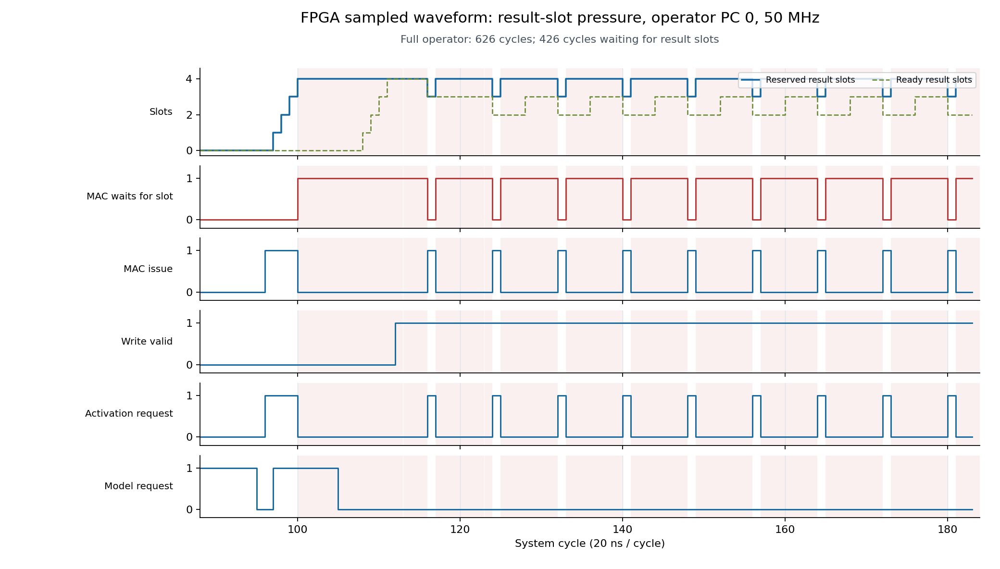

# no_cpu 逐算子波形实板验证（50 MHz）

2026-10-24，在 EGo1 V2.2 / xc7a35tcsg324-1 上完成新的片上采集器验证。通过现有 fabric JTAG 导出真实逐周期样本，再生成 VCD、CSV、JSON；此实现是自定义波形记录器，不使用厂商 ILA IP。最多 16 个硬件算子的完整统计与一个选定算子的 1024 × 128-bit 波形同时保留。

## 实板结论

- 新镜像共通过 **178 次输出逐字节比较**：常规回归 170 次、观察到 busy 后停 TCK 的长链 1 次、波形专项 7 次。常规套件包含 100 次变化输入重复推理、100/1000 kHz JTAG、watchdog/RESET 和训练权重的独立参考计算。
- **32 项反例/恢复检查**通过，包括运行中读 trace、未采集或非对齐 RAM、保留配置位和所有权限制。
- 常规回归保存并核对 **473 行逐算子统计**：相邻区间连续、描述符身份正确，分算子 MAC/等待计数加总等于整次计数。
- 7 组专项采集累计 **3992 个 FPGA 样本**。独立审计重读输入/期望/输出二进制与 SHA256，逐拍核对原始采样字、JSON、CSV 和 VCD；命令行再次读取的 425 个尾段样本与专项结果完全一致。
- 最后读取状态为 `2`（idle/model-ready）、error 为 `0`。保留 activation_tail 采集和 50 MHz SRAM 镜像；已关闭本次 OpenOCD、释放 FT232H 的 WSL 占用，未写 Flash。

## 已定位的拥塞及 boundary

压力用例 PC0 的完整时间为 **626 周期 / 12.52 μs**，其中 **426 周期等待结果槽**；波形显示周期 100 时 4 个槽已占满，`wait_slot=1`、MAC 发射暂停。槽释放时 MAC 恢复发射。槽等待触发窗口准确从周期 100 开始。

非融合 CNN 的算子边界如下。区间为 `[start, end)`，单位是 50 MHz 系统周期；此用例的 82 个结果槽等待周期全部归属于 Conv。

| PC | 算子 | start | end | 等待结果槽 |
| --- | --- | --- | --- | --- |
| 0 | Conv | 0 | 531 | 82 |
| 1 | Requant | 531 | 898 | 0 |
| 2 | ReLU | 898 | 1231 | 0 |
| 3 | MaxPool | 1231 | 1528 | 0 |
| 4 | FC | 1528 | 1833 | 0 |
| 5 | Requant | 1833 | 1988 | 0 |
| 6 | ReLU | 1988 | 2069 | 0 |

融合程序的 PC 对应编译后描述符；JSON 的 `logical_ops` 标注对应的逻辑算子组。

## 波形专项

以下文件位于 `build/validation_nocpu_trace_20261024/waveform_run_01/`，同名 `.vcd`、`.csv`、`.json` 均已生成。周期范围包含两端。

| 用例 | 样本数 | 周期范围 | flags | 核对重点 |
| --- | --- | --- | --- | --- |
| disabled | 0 | 无 | 4 | 关闭波形时逐算子汇总仍完整 |
| pressure_full | 626 | 0–625 | 5 | 完整样本信号计数与汇总相等 |
| pressure_trigger | 526 | 100–625 | 5 | 首样本即结果槽等待 |
| cnn_plain_pc1 | 367 | 531–897 | 5 | 精确选择 Requant 算子 |
| trained_pc1 | 1024 | 1211–2234 | 15 | 满窗并显式标记截断 |
| activation_head | 1024 | 0–1023 | 15 | 长算子头段与截断 |
| activation_tail | 425 | 16000–16424 | 5 | offset=16000 的末段及结束边界 |

flags：bit0 started、bit1 full、bit2 job finished、bit3 truncated。所有正常算子汇总 flags 为 `0xb`。独立 CLI 导出为 `build/validation_nocpu_trace_20261024/cli_activation_tail.vcd`。

## RTL、主机与实现

- 62 个程序回归场景通过，与此前仅含接口计数器的版本相比，周期、写事件及 24 项整次计数完全一致。
- 独立 trace RTL 测试覆盖采样字、偏移、触发、截断、失败、关闭、复位和未采集 RAM 保护；量化 20000 向量、memory/stall 测试通过。
- 主机测试共 14 项通过：trace 7、performance 4、transport 3。
- 最终布线 WNS **+0.669 ns**、WHS **+0.029 ns**、pulse width **+3.000 ns**，失败端点为 0，21522 根网络全部布线，无 DRC error 或内部无时钟/未约束端点。
- 资源：11046 LUT、9452 FF、8 BRAM tiles、48 DSP；采样 RAM 增加 4 BRAM tiles。
- 仍有 109 个 CDC-15 mailbox 警告、75 个 DSP 建议和 15 个 methodology 警告（LUTAR-1=1、SYNTH-6=10、SYNTH-10=4），分类及假设见最终 `review_gate.json`。

镜像：`build/fpga_ego1_50mhz_trace_impl_20261024/fpga_top_h16_50mhz.bit`。

SHA256：`cabf6baf0dd6c13b44bb907f7699a0f6ba52bff5c66e01de772c6bd9ad6efaf3`。

配置回读 `DONE=1`、`CRC_ERROR=0`。源码 SHA256 与最终实现记录逐项匹配。

## 复用与限制

使用方法、CSR 和位域见 [NPU_OPERATOR_TRACE.md](NPU_OPERATOR_TRACE.md)。选择 PC、offset 或 `--trigger-slot` 后重新推理，即可导出其他窗口。

50 MHz 下每窗最多 **20.48 μs**；超过窗口的算子统计仍完整，波形需分次重跑采集。VCD 的显示时钟按 20 ns 重建，不是示波器实测；采样看不到沿间毛刺。本版不记录写入 payload 或 MAC 内部数值。核心 RESET/watchdog 会清除采集，不能恢复复位前故障历史。

未执行物理复位按钮、断电重上电、电气/示波器、PVT 或长期老化验证。训练权重用例使用合成输入，不代表真实语音精度；两个超容量非融合模型仅验证主机拒绝，不计入上板通过数。

## 证据

- [持久化机器摘要](validation/nocpu_operator_trace_20261024.json)、[473 行算子统计](validation/nocpu_operator_trace_20261024.csv)。
- `build/nocpu_trace_rtl_final_20261024/summary.json`：62 场景与源码指纹。
- `build/fpga_ego1_50mhz_trace_impl_20261024/review_gate.json`：最终时序、告警分类、源码及镜像指纹。
- `build/validation_nocpu_trace_20261024/program/console.log`：下载及配置状态。
- `build/validation_nocpu_trace_20261024/board_run_01/{result,audit}.json`：常规实板结果；`commands.jsonl` 保存 55520 次主机交换。
- `build/validation_nocpu_trace_20261024/waveform_run_01/{result,audit}.json`：专项结果及独立审计；`commands.jsonl` 保存 22886 次主机交换。
- `build/validation_nocpu_trace_20261024/audit_waveforms.py`：可离线重新核对输出、指纹与全部导出波形。
