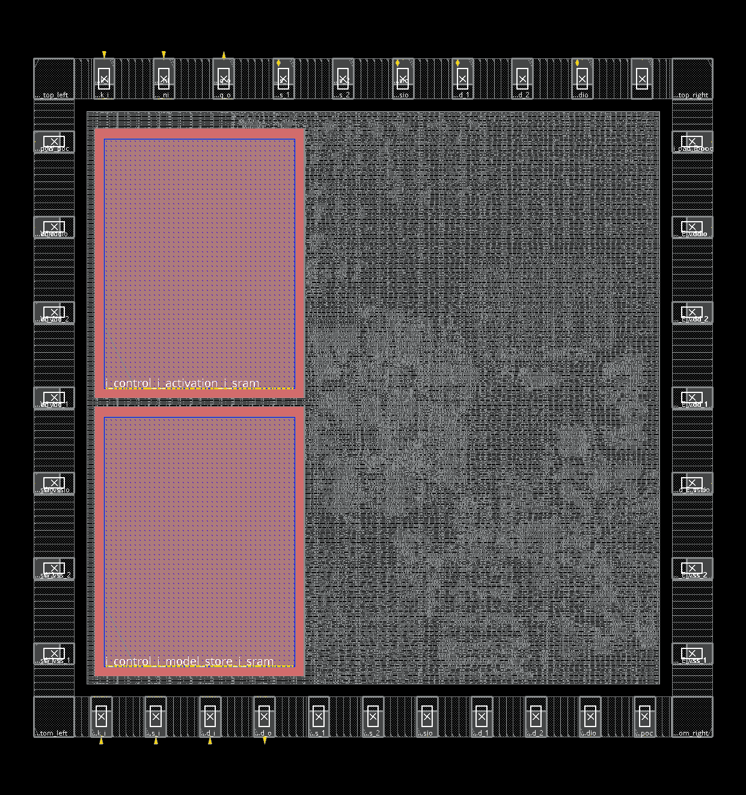
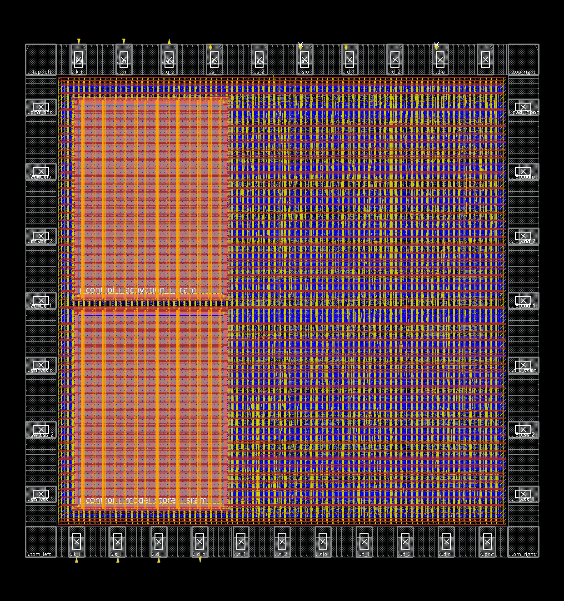
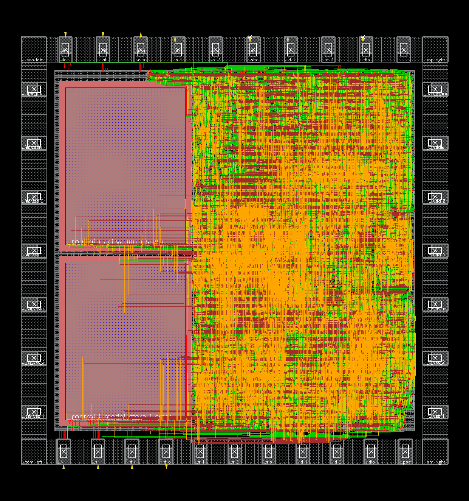
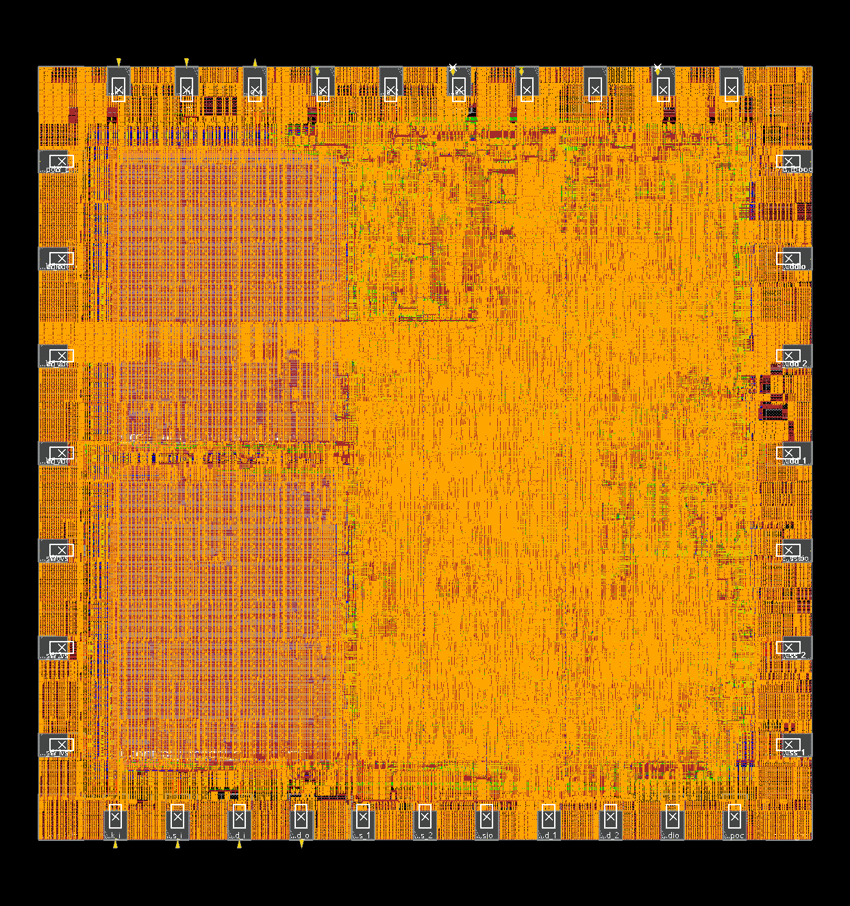
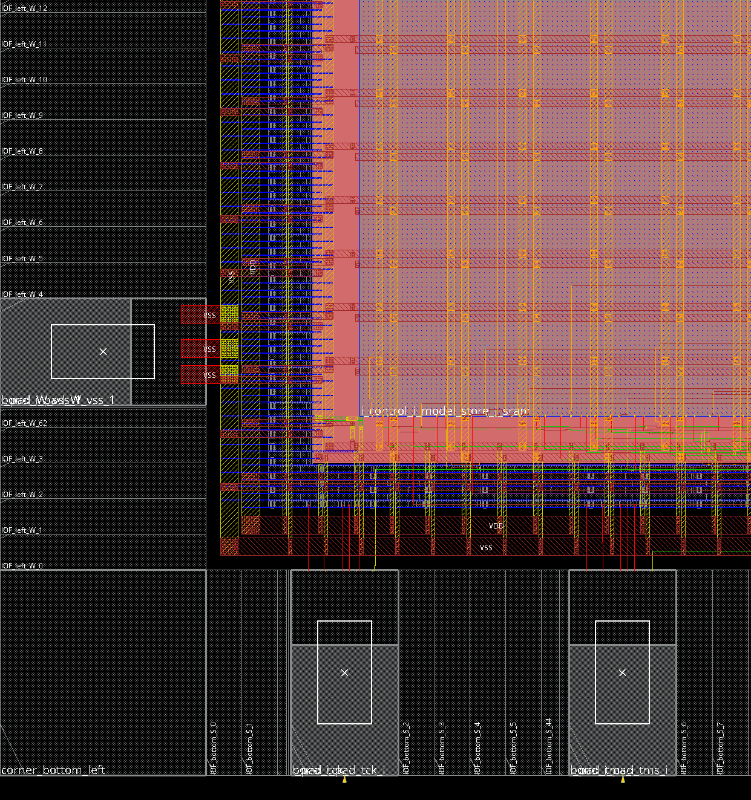
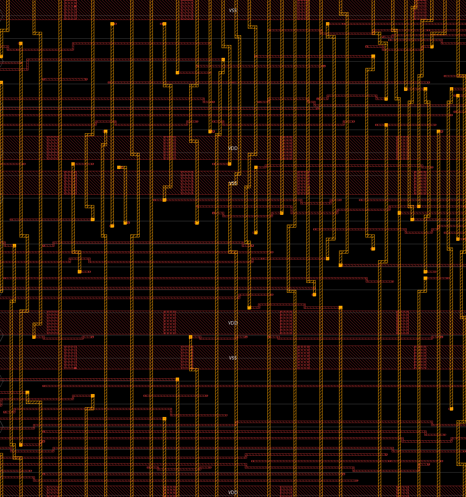
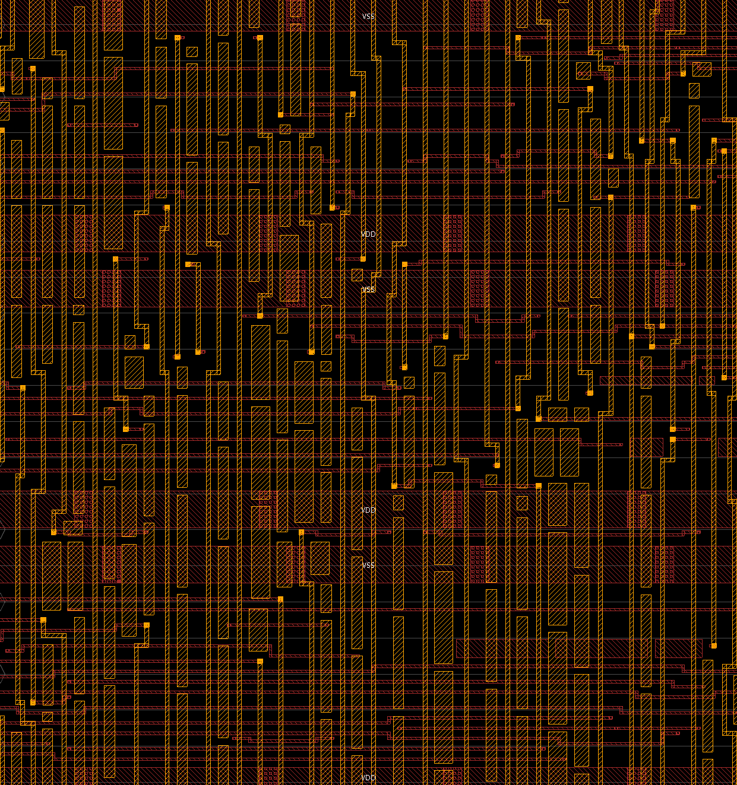

# 无 CPU 双 SRAM NPU：2×2 mm 整芯片实现与签核（2026-10-26）

本文记录 `feature/asic-pnr-optimization` 分支的最终结果：在 Die ≤ 2×2 mm（含 PAD 环）的约束下，
无 CPU、双 SRAM 的五算子可编程 NPU 完成了 RTL 优化、综合、整芯片 PnR、独立签核和 SDF 门级仿真。
所有数字都来自工具的实际报告；机器可读摘要见
[validation/nocpu_dual_sram_pnr_20261026.json](validation/nocpu_dual_sram_pnr_20261026.json)。

## 结论

| 层次 | 结果 |
|---|---|
| RTL 功能 | 70 个程序场景在行为 SRAM 和真实 SRAM 模型下均通过；课程基准 KWS/MNIST/HAR 通过，ECG 不支持 |
| 性能 | TinyCNN（KWS，4×8）**3262 周期**：比双 SRAM 基线 3826 快 14.7%，比原 4 KiB 寄存器版本 3470 快 6.0% |
| 综合 | 标准单元 1.313 mm²，两颗 SRAM 0.803 mm²，合计 2.116 mm² |
| PnR | Die **1940.4 × 1940.4 µm = 3.765 mm²**（上限 4.0 mm²），setup +0.165 ns，hold +0.025 ns，9 项物理检查全部通过 |
| 可复现性 | 独立重复运行结果逐项一致 |
| 签核 | Calibre DRC、Calibre LVS、PrimeTime、Formality 全部通过（判定规则见下） |
| SDF 门级仿真 | 基线（u70）和入选版图均通过：70 条 JTAG 命令全过，0 时序违例 |

范围：只做 TT 1.8 V 25 °C 一个工艺角，50 MHz 核心时钟、1 MHz JTAG。没有多角 STA、IR/EM、
密封环和芯片级 ESD 评审。功耗为 Innovus 无激励静态估算，不是工作负载功耗。

## 设计与约束

- 架构：主机经 JTAG 发送 ABI 2.1 描述符；五算子（Conv、FC、MaxPool、ReLU、Requant）；
  4×8 MAC 阵列（保留 4×4 配置）；INT8；空间分块 TILE=16。
- 存储：模型区和激活区各一颗课程宏 RA1SHD_2048x32M8（8 KiB，554.6 × 723.9 µm）。
  激活 SRAM 是单端口，配有读缓存、写合并队列和转发。
- 通用性底线：不针对 TinyCNN 形状写死数据通路，不跳过描述符校验，不固化模型参数。

## RTL 优化（性能）

| 改动 | 提交 | KWS 周期 |
|---|---|---:|
| 双 SRAM 基线（edcb86e） | — | 3826 |
| 激活 SRAM 读缺失优先使用端口，写队列快满或 flush 时才让写 | 47d7276 | 3448 |
| 取指流水：收到描述符/参数响应的同一拍发出下一读 | 9e4a32c | 3346 |
| ABI 2.1：≤4 通道的尾 tile 按 4 字节/行打包权重 | 7ff19f9 | **3262** |

最终 RTL 的课程基准（真实 SRAM 模型，逐次核对全部张量写回）：

| 网络 | 4×8 周期 | 4×4 周期 | 基线 4×8 |
|---|---:|---:|---:|
| KWS（TinyCNN，主指标） | **3262** | 5886 | 3826 |
| MNIST | 5777 | 5762 | 6705 |
| HAR | 1025 | 1240 | 1164 |
| ECG | 不支持（MaxPool1D） | 不支持 | 不支持 |

ABI 2.1 改变了窄 tile 的权重布局，旧模型包需要重新编译；主机库版本检查会拒绝不匹配的 ABI。

## 面积

ASIC 默认关闭逐算子统计（`NPU_ENABLE_OP_TRACE=0`，能力寄存器仍可探测；仿真和 FPGA 默认打开，提交 2fbd46c）。
综合时标准单元面积从 1.582 mm² 降到 1.313 mm²（−17%）。

| 项目 | 面积 |
|---|---:|
| 标准单元（综合） | 1.313 mm² |
| 两颗 SRAM | 0.803 mm² |
| 合计（综合） | 2.116 mm² |
| 核心区 | 1640 × 1640 µm = 2.690 mm² |
| Die（含 PAD 环） | 1940.4 × 1940.4 µm = 3.765 mm² |

对比：原 main 分支的单 SRAM 版本综合 3.554 mm²（4 KiB 寄存器激活存储占 2.112 mm²），
只做过不含 PAD 环的核心块 PnR（60% 时 2459.5 µm 见方）。

## PnR 搜索

流程：`hardware/asic/optimize/flow.py search`，源码 1bc4a68，综合结果复用（RTL、文件列表、约束和
synth.tcl 未变，来源记录在服务器 PROVENANCE）。按 Die 面积优先排名，只有全部检查通过的候选参与排名。

| 候选 | Die | setup | hold | 结果 |
|---|---:|---:|---:|---|
| u55–u65 | > 2 mm | — | — | 超预算，未启动 Innovus |
| u70 west_stack | 3.765 mm² | +0.035 ns | +0.021 ns | 合格 |
| u75 west_stack | 3.687 mm² | −0.099 ns | +0.020 ns | DRV 违例，不合格 |
| u70 south_row | 3.765 mm² | −0.231 ns | +0.018 ns | 不合格 |
| u70 diagonal | 3.765 mm² | −0.082 ns | +0.021 ns | 不合格 |
| **u70 west_stack + 拥塞驱动** | **3.765 mm²** | **+0.165 ns** | **+0.025 ns** | **合格，入选** |
| 独立重复 | 3.765 mm² | +0.165 ns | +0.025 ns | 与入选一致 |

入选版图：

| 指标 | 数值 |
|---|---|
| 标准单元 | 55,214 个，1.333 mm²（含 CTS 与时序修复） |
| 密度 | 按面积 70.6%；Innovus 报告 78.7%（分母扣除 SRAM halo 和电源环） |
| 总线长 | 3.66 m（DEF 走线中心线，不含特殊网络） |
| 全局布线溢出 | 0.48% H / 0.28% V |
| 静态功耗估算 | 约 129 mW（输入/时序翻转率 0.1） |
| DRC / 天线 / 电源 DRC | 0 / 0 / 0 |
| 信号与电源连通性 | 通过（仅 IO 拼接轨 VDDPST/VSSPST 的两条无布线信息） |

### 流程修复

- 70% 时实际密度 78.9%，课程默认 `-maxDensity 0.75` 让 hold 修复停止，留下 −1.39 ns。
  放宽到 0.9 后 hold 收敛；新增单元不到标准单元面积的 0.7%（417f3b8）。根因是时钟偏斜约 1.7 ns，
  后续可在 CTS 阶段改善。
- M5/M6 金属密度低于代工厂 30% 下限：布线后插入浮空金属填充，再做最终 DRC 和寄生提取（f01a3ca）。
- 每颗 SRAM 的 M5 条带在环外留下悬空线头：`editTrim` 清除；电源检查只放行 IO 拼接轨两条信息（c2bb86e）。
- 仿真网表导出参数冲突、Die 对齐超出 2 mm、时序角命名、IO 电源全局连接等问题（ce562c2、9eb76e4、52043e4）。

## 独立签核

`hardware/asic/optimize/signoff.py`，在导出文件上用 Innovus 以外的工具复核：

| 检查 | 工具 | 结果 | 判定说明 |
|---|---|---|---|
| DRC | Calibre 2022.3 | 通过 | 2427 条结果均已分类放行：2425 条 ESD/闩锁指导性规则（`g` 后缀）和 1 条器件层规则 CO.R.4，全部位于 IO 环内的厂商 IO 单元；1 条规则文件固定提醒 DRM.R.1。其他任何结果都会阻断 |
| LVS | Calibre 2022.3 | 通过 | 端口、网络、器件拓扑完全一致；45 处 IO PAD 多晶硅电阻阻值偏差 3.47%（IO SPICE 270a 与 GDS 280a 的版本差），容差 5% |
| STA | PrimeTime R-2020.09 | setup +0.671 ns，hold +0.015 ns | 节点没有 Library Compiler，SRAM .lib 无法转 .db，两颗 SRAM 作黑盒；SRAM 接口时序只由 Innovus 检查 |
| 等价性 | Formality R-2020.09 | 通过 | 综合网表与布线后网表；SRAM 黑盒 |

为让签核在真实版图上运行所做的修正（f8965ca）：规则文件精度改为 GDS 的 2000 dbu；
给 IO 环 POC 导轨加顶层标签；开启 split-gate 合并（IO PAD 内 NOR2 为叉指结构）；
去掉 Innovus SDC 中 PrimeTime 不接受的 `current_design`；PrimeTime 启动时的 PT-063 提示单独记录。

## SDF 门级仿真

`postlayout.py`：布线网表 + SDF（编译期 `-sdf_cmd_file` 标注），通过物理 JTAG 加载数据、运行两次推理、
检查中断和复位恢复（ABI 2.1），不使用层次后门。

- Xcelium 会忽略运行时文件名的 `$sdf_annotate`，之前的仿真实际是零延迟（14ef6f7）。
- 只对 6 个跨时钟域采样触发器关闭时序检查：req/ack 同步器第一级和两组复位同步器；
  名单从网表精确匹配并保存。其余所有检查保持开启，任何违例都判失败（1bc4a68）。

验收结果（基线 u70 与入选版图相同）：

| 项目 | 结果 |
|---|---|
| JTAG 命令 | 70 条全部通过，复位后读回 ABI 0x20001 |
| 时序违例 | 0 |
| 未知实例、未标注的检查等其他告警 | 0 |
| 放行：组合单元 ifnone 默认路径（SDFNEP） | 约 6.6 万条，全部核对为模型声明的 `ifnone` 弧（全加器、XOR/XNOR、MUX 等），只在输入为 X 时使用 |
| 放行：SRAM 下降沿 PERIOD（SDFNET） | 模型只检查上升沿周期（3 ns < 20 ns） |
| 放行：第 0 时刻输入 PAD 冲突 | 5 个输入 PAD 各 1 次（tie 单元尚未传到 OEN） |
| SRAM CLK→Q | SDF 中 64 条 `(posedge CLK) Q[i]` 去掉沿标记后标注（模型为 `(CLK => Q[i])`），改写记录在 `sdf/sdf_rewrite.json` |

仿真使用 `+define+NTC +define+RECREM +neg_tchk`（TSMC 模型的负时序检查用法，使 RECREM 恢复/移除检查生效），
并以 `-ignr_warnmax` 取消告警截断，保证审计的是完整日志。

这一步在扫描结束后，以本分支最终的 `postlayout.py` 单独运行（扫描冻结的旧版验收脚本在基线上判失败，
失败记录保留为 `sdf_attempt1/2`）。PnR 产物在验收前后哈希一致。

## 版图截图（Innovus 渲染）

截图脚本：`hardware/asic/optimize/screenshots.tcl`（Xvfb 下运行 Innovus GUI，读取数据库副本）。

| 视图 | 文件 |
|---|---|
| 器件摆放：两颗 SRAM、标准单元、PAD 环 |  |
| 电源网络：核心环、SRAM 环、条带 |  |
| 信号布线（不含填充） |  |
| 全部图层（含填充） |  |
| 西南角：角单元、IO 填充、信号 PAD、打线开口、SRAM 环 |  |
| 同一 80 µm 窗口 M5/M6：填充前 |  |
| 同一 80 µm 窗口 M5/M6：填充后 |  |

## 复现

服务器（课程节点，先 `source /opt/eda/env.sh; source /lec/eda.env`）：

```bash
python3 hardware/asic/optimize/flow.py search --output /absolute/new/experiment
python3 hardware/asic/optimize/signoff.py --candidate /absolute/new/experiment/candidates/congestion
```

本地：

```bash
python3 -m unittest discover -s hardware/asic/optimize -p 'test_*.py'
python3 hardware/npu/scripts/run_course_benchmarks.py --trained-model software/models/tinycnn8_flatten_strong.npz
```

GDS、DEF、SPEF、SDF、数据库和工具日志保存在服务器实验目录 `pnr-dual-1bc4a68/`，不进入仓库。
