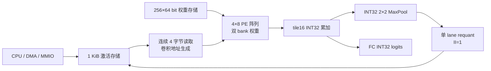

# 当前融合 NPU 的延迟与面积优化分析

日期：2026-10-15。目标板卡：EGo1，Artix-7 `xc7a35tcsg324-1`，系统时钟 50 MHz。
用户提供的整机资源基线约为 60%，未取得 LUT/FF/BRAM/DSP 分项报告。
本文基于当前源码、临时 RTL 副本的 Icarus 仿真和独立 NPU 综合；不修改生产 RTL。
源码基线提交：`8394533c5f3830dd3825f76d0a360b82407d573c`。

## 1. 实际运行的架构

`my_soc_top → my_npu_subsystem → tinycnn8_npu_mmio_wrapper → tinycnn8_npu_fused`。
默认 `FUSED_CORE=1`，不是旧分层核，也不是旧 GAP 网络。

网络：`20×16×1 → Conv 1→8 → Pool → Conv 8→8 → Pool → Flatten 160 → FC 4`。
激活输入占 320 B，Pool1 占 640 B，Pool2 占 160 B；Pool2 覆盖已经死亡的输入区域。
Conv 输出不落地，池化先于量化，因此当前不需要 2,560 B 的 Conv1 特征图存储。

重要参数陷阱：融合核的 `ACT_BANK_BYTES`、`SPATIAL_TILE`、`OPT_GATHER_LOAD`、
`OPT_SPATIAL_TILE` 仅为接口兼容而保留，实际未使用。真实容量和 tile 是
`localparam ACT_BYTES=1024`、`TILE_POS=16`。直接扫描这些形参不会改变当前融合核。
旧 tiled 报告针对分层路径，不能将其收益套用到当前生产核心。

## 2. 已复现的周期瓶颈

在临时副本中把 `begin_layer();` 改为 `begin_layer;`，解决本机 Icarus 的空参数 task
语法兼容问题；生产源码未变。用监视器按互斥原因统计每一拍，并检查 Pool1、Pool2 和 logits。

| 阶段 | 总周期 | 阵列发射 | 等待权重 bank | 等待窗口缓冲 | 尾部排空 |
|---|---:|---:|---:|---:|---:|
| Conv1 + Pool1 | 1,000 | 960 | 4 | 0 | 36 |
| Conv2 + Pool2 | 1,480 | 1,440 | 4 | 0 | 36 |
| FC | 325 | 40 | 273 | 0 | 12 |
| 总计 | 2,805 | 2,440 | 281 | 0 | 84 |

核心延迟为 `2805 / 50 MHz = 56.1 µs`。该数字不包含输入装载、log-mel、输出读取和分类。
测试台等待 done 的循环显示 2,806；此处统一采用硬件 PERF_TOTAL 的 2,805。
两层卷积已连续发射，单 lane 量化没有造成中途阻塞。
FC 的发射间隔为 `4,12,4,12,...`，显著受权重 bank 复用限制。

## 3. 已验证的小改动：FC 按行提前释放权重 bank

当前 loader 要等该 bank 的所有事务从阵列输出退休，才能装下一组权重。
实际上第 r 行最后一次读取旧权重的时刻，是最后一次输入到达该行最后一列的时刻；
随后可以逐行覆盖，部分和和 tag 继续沿阵列传播。

临时实验只针对 FC 使用两个 4-bit bank age 计数器。发射时 age 设为 1，达到
`ARRAY_COLS-1` 后允许从第 0 行开始逐拍写入；同一边沿计算读取旧寄存器值，
权重更新通过非阻塞赋值生效。卷积仍保留原有完整退休条件，完成检测仍使用真实 in-flight。
该释放规则依赖当前 PE 时序；增加阵列流水级后必须重新推导安全时间。

| 方案 | C1+P1 | C2+P2 | FC | 总周期 | 50 MHz 延迟 |
|---|---:|---:|---:|---:|---:|
| 当前默认 | 1,000 | 1,480 | 325 | 2,805 | 56.1 µs |
| FC 按行提前释放 | 1,000 | 1,480 | 230 | 2,710 | 54.2 µs |

FC 缩短 29.2%，整体缩短 3.39%。不增加 PE、权重容量或 DSP，RTL 只增加 8 个计数器位及比较逻辑。
实际独立综合增量为 **10 LUT、6 FF，DSP 与存储不变**。
该方案通过 19 组 synthetic golden，每组连续推理两次，覆盖 1–8 类、random/impulse/extreme。
它仍是实验副本，尚未进入 MMIO/SoC 集成回归或真实语音回归。

## 4. 按收益与资源代价排序的其他方向

| 顺序 | 方向 | 对延迟的作用 | 主要资源代价 | 建议 |
|---|---|---|---|---|
| 1 | FC 按行释放 bank | 已实测整体 -3.39% | 少量计数器与控制逻辑 | 最容易落地的核心周期优化 |
| 2 | 输入 MMIO 每次写 4 B | 320 次写变成 80 次，降低逐帧装载时间 | 分 bank 写使能、32-bit host 数据路径 | 优先测端到端延迟后实施 |
| 3 | 地址/激活读取流水线并提频 | 保持 II=1，用更短时钟周期加速所有层 | 数据、tag、bank/valid 寄存器 | 提频收益可能高于继续扩大存储 |
| 4 | 存储组织与位宽优化 | 降低布线/选择器成本，为提频或增带宽腾资源 | 可能需要同步读取和控制对齐 | 搜索 bank、端口与实现方式，而非只搜索字节数 |
| 5 | 跳过全 padding 向量 | 当前 240 次发射没有有效输入 | 调度、bias/首末组与池化管理 | 先做压缩调度模型，不能只屏蔽 in_valid |
| 6 | FC streaming SIMD 模式 | 减少低复用 FC 对 WS 调度的依赖 | 更宽权重口及 PE 数据路由 | FC 占总延迟仅 11.6%，放在小改动之后 |

### 4.1 输入装载与 DMA

wrapper 当前 `0x1000 + 4*i` 每次只取 `wdata_i[7:0]`，320 B 输入要 320 次 MMIO 写。
已有 DMA 是逐 32-bit word、单 outstanding 的读-写复制，不支持 burst，也不会自动把
一个 word 拆成四个输入字节。按当前 ABI，输入 DMA 源需要每个有效 byte 占一个 word。

建议保留原窗口兼容性，增加 packed 输入窗口：一次 aligned word 写四个连续 byte，
分发至四个不同 bank。CPU 或 DMA 只需 80 个 word，源数据也只需 320 B。
若单次有效 MMIO 写平均耗时为 Lw 周期，则仅事务部分约节省 `240×Lw`；
CPU 循环和源读取的收益另算，不能把端到端加速直接声称为 4 倍。

输入双缓冲主要改善连续帧吞吐和等待下一帧的时间，不直接缩短孤立单帧的计算延迟。
需要新增输入缓冲、明确所有权，并改变当前 busy 时禁止输入写入的规则。
权重/参数应跨帧保留，只把模型初始化计入冷启动。

### 4.2 提频与流水线

独立 NPU 基线综合网表的最慢寄存器间路径从 `issue_g_reg[2]` 到第一个 PE 的 DSP 输入：
地址生成 → LUTRAM 异步读 → activation 选择 → DSP。
50 MHz 下该综合估计 WNS 为 +5.917 ns；尚未布局布线，host I/O 延迟未约束。

建议先尝试 62.5 MHz 的整 SoC 实现，再做输入读取流水线尝试 75 MHz。
Conv2 的 `/3`、`%3` 地址逻辑可用显式 ky/kx/channel-half 计数器或小查找表比较，
同时约束地址运算位宽，避免无必要的 32-bit integer 运算。
增加读取级时同步延迟 valid、tag、weight bank 选择和相关占用计数，保持每拍 1 次发射。
若 PE 再增加 DSP 内部流水线，也必须调整斜移、输出对齐及 bank 安全时间。

仅作条件换算：2,710 周期在 62.5 MHz 为 43.36 µs，在 75 MHz 为 36.13 µs。
这些频率尚未在整机实现中验证，不能据独立综合网表认定板上可用。
AMD 说明 DSP 寄存器优化可改善 DSP 内部及进出路径时序：
[UG904 DSP Register Opt](https://docs.amd.com/r/2024.2-English/ug904-vivado-implementation/DSP-Register-Opt?contentId=mvIxYhFNCh9HC1frqClQjA)。

### 4.3 存储与位宽搜索应该怎样做

**激活容量：** 同时活跃的输入+Pool1 共 960 B，当前 1,024 B 已非常紧凑。
1,024→960 B 仅减少 64 B，实际 LUTRAM/BRAM 颗粒可能使资源不变；扩大容量也不减少当前发射数。

**tile 容量：** 当前 tile16 的 psum 为 512 B，窗口为 128 B。
卷积每拍发射且窗口等待为 0，tile32 会增大 psum/窗口存储，但没有明显的中途气泡可以消除。
tile8 可能缩小缓冲，却暴露双 bank 的装载/复用等待；需要真正参数化后测完整周期，
不能直接套用旧分层核的 tile sweep。

**bank 数：** 每拍最多读取四个连续 byte，四个 byte bank 理论上足够无冲突读取。
可比较 4 bank 与 8 bank 的旋转 mux、地址路径和物理时序；总字节容量可以不变。
如果后续增加 8 B/拍或双读向量，则 8 bank 更有意义。此方向未做 RTL 实验。

**存储实现：** 当前权重、激活和 psum 都使用异步读，独立综合实际映射为 LUTRAM。
适合先尝试把 256×64-bit 权重存储改为同步读 BRAM，并提前发地址，保持 loader 吞吐。
激活和 psum 的同步读会影响 operand/tag 对齐或累加依赖，改造成本较高。
仅加 `ram_style="block"` 无法解决异步读接口与 BRAM 的语义差异。
AMD 明确指出异步读需要 distributed RAM：
[UG474 Distributed RAM Applications](https://docs.amd.com/r/en-US/ug474_7Series_CLB/Distributed-RAM-Applications)。

**阵列内部和：** 每个 issue 只求四个 INT8×INT8 乘积之和，范围
`[-65024,65536]`，18 位有符号数足够；跨 K 累加、bias、MaxPool 和 logits 继续使用 INT32。
已在临时副本验证 18-bit 内部和，组合 FC 优化后仍为 2,710 周期，19 组 golden 全部通过。
RTL 声明的 PE 和输出 deskew 位数最多减少约 840 bit，但原综合可能已折叠冗余符号位，
最终节省必须看综合对比，不能把声明位数当作 FF 节省。
本次综合相对 FC 调度版实际减少 84 LUT、196 FF；组合方案相对生产基线减少 74 LUT、190 FF。

**完整 psum 和 multiplier：** 直接改成 24-bit accumulator 或 16-bit multiplier 需要更强约束。
任意 INT32 bias 不能安全收窄；Q31 multiplier 截断也不能保证 double-rounding 逐位一致。
当前工作区没有实际训练部署包可供检查，暂不建议把这两项当作无损优化。

**四分类权重压缩：** FC 160 个 64-bit word 的高四 lane 不参与四分类计算。
可将 FC 权重压到 640 B，再与 Conv 权重的 648 B 合并规划；它有机会省存储或为 FC 增带宽，
但单纯减少字节数不减少计算周期，而且会影响 1–8 类 ABI 和导出格式。

### 4.4 padding 与计算映射

监视器测得 Conv1 有 32 次全 padding issue，Conv2 有 208 次，共 240。
即便完全消除这些拍且没有新增停顿，节省上界也只有 `240/2805 = 8.56%`。
这不是已实测加速：必须压缩 schedule，并处理某位置 first/last group 被跳过时的
bias 初始化、psum、池化完成、tag 和 weight bank 生命周期。压缩后较短的组还可能重新暴露装载等待。

Conv1 每组只有三个有效 K 行，第四 PE 行闲置；FC 四分类只使用八列中的四列。
但简单把九个 Conv1 tap 重新装成 4+4+1，依然需要三次 issue，不会自然减少周期。
想提高利用率需要阶段特定的 spatial/SIMD 映射和数据路由，复杂度明显高于 FC 小调度改动。
Conv 的输出通道已经是 8，直接将阵列扩到 16 列没有足够的通道填满新增列。
扩 K 行可以加速 Conv2，但需同时增加读带宽、DSP 与累加数据路径；约 60% 的总资源占用
不能说明 DSP 也有同等余量，应先看分项资源和 routed timing。

## 5. 证据与落地顺序

实验目录：`work/latency_analysis_20261015/`（Git 忽略）。
`profile.py` 生成临时语法兼容副本、FC 调度副本、18-bit 阵列副本和监视器；
`profile.log`、`summary.json` 保留完整结果。三个方案各 19 例、每例两次，
共 92,112 次 Pool1/Pool2/8-lane 输出检查，synthetic 测试不替代真实模型回归。
Windows 本机仿真需在普通本机权限下运行；Icarus 的数据路径使用仓库相对路径避开中文路径限制。

独立综合只包含 NPU，器件与 EGo1 一致。综合网表数据不能替代整 SoC 约 60% 的资源基线，
也不能替代 place/route。Vivado 在中文目录首次中途退出；英文目录重试生成的报告已复制回实验目录。

独立 NPU 综合结果（Vivado 2025.2，相同默认综合选项，未布局布线）：

| 方案 | Total LUT（含 LUTRAM/SRL） | FF | DSP | BRAM | 总周期 |
|---|---:|---:|---:|---:|---:|
| 当前默认核 | 4,125 | 3,410 | 36 | 0 | 2,805 |
| FC 按行释放 | 4,135 | 3,416 | 36 | 0 | 2,710 |
| FC 按行释放 + 18-bit 阵列内部和 | 4,051 | 3,220 | 36 | 0 | 2,710 |

三种方案的 LUTRAM 均为 1,312。组合方案的 NPU LUT/FF 分别减少约 1.8%/5.6%。
报告为 `baseline_util.rpt`、`fc_row_release_util.rpt`、`fc_array18_util.rpt` 和对应 timing 文件。
综合没有预先提供 timing-driven 时钟约束，完成后以 20 ns 时钟评估寄存器间时序；
所有方案使用相同设置，适合资源对比，不宜据此预测优化后的最高频率。
全部综合任务成功退出，未生成或烧写 bitstream。

建议实际实施顺序：

1. 合入 FC 安全释放优化，并跑 MMIO、SoC 和真实部署包的 bit-exact 回归。
2. 量取逐帧的输入装载/核心/输出时间；增加 packed 输入窗口，复用现有 DMA。
3. 用完整 SoC routed timing 试 62.5 MHz；针对最慢路径增加读取流水级，再试 75 MHz。
4. 用相同测试与实现约束扫描存储 bank、权重 LUTRAM/BRAM、内部和位宽，选择资源/延迟的折中点。
5. 前面收益确认后，再评估 padding 压缩与 FC streaming 模式。
