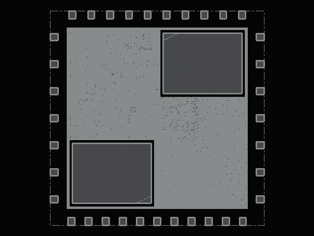
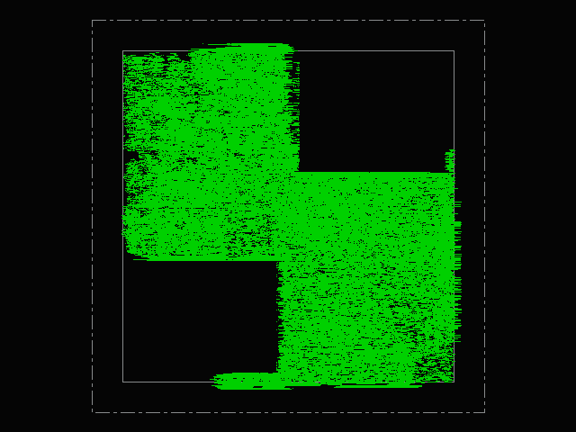

# ABI 5.0 NPU 最新版本后仿报告

报告日期：2026-11-11（Asia/Shanghai）。冻结版本：aa778875eed49ada6b7b36bf10b1c0cdce2ad3c9。

本轮从远程 main 的 aa77887 归档源码重新运行综合和布局布线，并使用新导出的网表、寄生参数和 SDF 执行后仿。此前归档数据仅用于对照，不作为本轮通过证据。

## 本轮结论

| 项目 | 本轮结果 | 范围 |
| --- | --- | --- |
| 物理实现 | PASS | die 1.9404 × 1.9404 mm；上限 1.950 × 1.950 mm |
| 布线后时序 | setup 0.486 ns / hold 0.050 ns | TT、core 50 MHz / TCK 1 MHz |
| 功能回归 | 170 / 170 | 两组配置；每个程序连续两次推理 |
| SDF 门级后仿 | 3 / 3 | 真实 I/O PAD、JTAG、SRAM，最大延迟回标 |
| 独立检查 | STA: PASS, LEC: PASS, DRC: PASS, LVS: PASS | 按项目原有原型验收策略；原始 DRC/LVS 结论见后文 |

本次属于课程／原型后端验证。Calibre 的原始记录、IO 库版本差异及 SRAM 独立 STA 范围均单列，不能把本报告解释为可流片签核完成。

## 当前远程进度与配置

交付前远程 main 新增 1d686d1，归档同源 aa77887 的 FPGA JTAG 扫频结果：新 FPGA setup/hold 为 +0.458/+0.034 ns，细扫 3360 次推理正确；该提交没有修改生产 RTL 或软件代码。本轮 ASIC 冻结输入不变；FPGA 高频功能测试不替代对应频率的物理签核。

ABI 5.0 保持 8×8 阵列、INT4/u4 数据路径、最多 128 条描述符以及两颗 2048×32 bit SRAM（总计 16 KiB）。main 已整合权重流水、双宏访问／旁路、阵列寄存器使能及主机 JTAG 批处理。aa77887 进一步将 lookup 表由 256 项收缩到 129 项，并正式启用库内集成时钟门控。

| 配置 | 采用值 |
| --- | --- |
| 工艺与工作点 | 课程 TSMC 180 nm，六层金属；TT，核心 1.8 V、IO 3.3 V、25°C |
| 时钟及约束 | core 20 ns；TCK 1000 ns；uncertainty 0.2 ns；IO delay 2 ns |
| ASIC 调试配置 | NPU_ENABLE_WAVE_TRACE=0；NPU_ENABLE_OP_TRACE=0；保留全局性能计数器 |
| 物理参数 | diagonal_facing；估算 utilization=0.75；halo=26 µm；hold 优化目标=0.12 ns |
| 工具 | Genus 19.17；Innovus 21.16；Xcelium 21.09；Calibre 2022.3；PrimeTime / Formality |

<!-- pagebreak -->

## 1 功能验证与逐测试结果

| 检查 | 结果 | 验证内容 |
| --- | --- | --- |
| flow 单元测试 | 44 / 44 | 原始 unittest 日志保存在 reports/ |
| software 单元测试 | 20 / 20 | 原始 unittest 日志保存在 reports/ |
| host 单元测试 | 17 / 17 | 原始 unittest 日志保存在 reports/ |
| tooling 单元测试 | 14 / 14 | 原始 unittest 日志保存在 reports/ |
| golden 单元测试 | 30 / 30 | 原始 unittest 日志保存在 reports/ |
| 行为存储 RTL | 85 / 85 | 含 7 个发布模型首帧、4 个实际 JTAG 配置；每程序两次推理 |
| 课程 SRAM 宏模型 + 波形关闭 | 85 / 85 | Icarus 功能检查；不执行 specify 时序检查 |
| 负例及生命周期 | 两组各 19 类 | 非法 opcode/ABI/shape/地址/shift、128 描述符边界、中止、超时与不完整装载 |
| 块级检查 | PASS | 20,000 组量化向量、4/8 列 INT4 MAC、双 SRAM、随机背压、写回排空、转发与共享存储压力 |

两组回归的周期、写入次数及性能计数器逐项一致。每个程序检查物化张量写入和最终输出。逐程序结果见附录及 rtl_full_cases.csv / rtl_macro_waveoff_cases.csv；19 类负例名称及输入 RTL 哈希见对应 provenance.json。

### 融合与非融合的实际对照

| 配置 | 首次 / 热运行周期 | 首次 / 热运行写入次数 |
| --- | --- | --- |
| cnn_c8_f1_j0 | [523, 522] | [24, 24] |
| cnn_c8_f0_j0 | [1444, 1444] | [305, 305] |

上述周期来自功能 RTL。门级后仿另外执行融合及非融合 CNN；本报告不把 RTL 的 170 个配置说成 170 个 SDF 后仿通过。发布模型仅检查冻结 golden 的首帧，本轮未重新训练或测量数据集准确率。

<!-- pagebreak -->

## 2 综合与面积归属

| 综合指标 | 本轮结果 |
| --- | --- |
| 标准单元面积 | 1,394,641.294340 µm² |
| 两颗 SRAM 面积 | 802,887.187500 µm² |
| 总库单元面积 | 2,197,528.481840 µm² |
| 映射叶单元数量（含宏） | 59574 |
| 触发器 / 被门控触发器 | 16411 / 15853 |
| ICG 数量 | 394 |
| 库标记时序单元面积 | 734,314.157 µm² |
| 综合最差路径 | 见 reports/synthesis_timing.rpt；布线后结论另列 |

本轮标准单元面积与 2026-11-10 归档的 1,394,641.294 µm² 一致。归档所述相对旧实现降低 22.48% 属于历史基线比较；本轮未重新综合旧实现，因此不把它当作新的 A/B 实验。ICG toggle saving 为综合估计，不等于芯片实测节电率。

### 布线后逻辑模块面积

| 模块分组 | 几何面积 mm² | 实例数 |
| --- | --- | --- |
| NPU | 1.188325 | 50532 |
| shared_store_logic | 0.158860 | 8629 |
| controller | 0.060726 | 3200 |
| host | 0.023168 | 842 |
| backend_or_unattributed | 0.000378 | 45 |

综合 cell area 来自 Liberty；物理面积来自实际实例矩形。模块按保留层次名称归组，无明确归属的 CTS/ECO 单元列入 backend_or_unattributed。详细寄存器、库主单元及物理单元统计见 physical_area_breakdown.json 和 synthesis_area_breakdown.json。

<!-- pagebreak -->

## 3 物理实现、时序与功耗

| 指标 | 本轮结果 | 解释 |
| --- | --- | --- |
| 实际 die | 1.9404 × 1.9404 mm | 数据库 / DEF 实测；含 PAD 环，未加 seal ring |
| die 面积 | 3.76515216 mm² | 课程上限 3.8025 mm² |
| core 面积 | 2.69038726 mm² | 包含 SRAM 和放置空白 |
| 活动标准单元面积 | 1,431,456.9920 µm² | 63248 个实例 |
| SRAM 几何面积 | 802,887.1815 µm² | 2 颗 |
| 可放置行密度 | 84.613% | timeDesign 最终统计；估算 utilization=75% 是另一口径 |
| setup WNS / TNS | 0.486 / 0.000 ns | 传播时钟、布线寄生、SI |
| hold WNS / TNS | 0.050 / 0.000 ns | 同一 TT 分析视图 |
| 信号布线长度 | 5.019798 m | 从 routed DEF 统计 |
| CTS / 后续修复净面积变化 | 23,890.362 µm² | 最终相对 pre-CTS 活动标准单元面积差 |

### 电气约束、拥塞及 CTS

原生主流程首轮完成后，普通约束报告通过，但独立 SI 扩展审计发现 49 条 max_tran 违例（最差 −1.040 ns）。因此另建 latest_diag75_drvfix 执行自动 postRoute DRV 优化，并在 latest_diag75_drvfix2 对残余网络驱动做定点增强，逐项核对库内逻辑函数相同，再完整执行天线、DRC、寄生提取和导出。没有修改生产 RTL、时钟、die 或扩大时序例外。旧版三组 SDF 结果保留，未用于证明修复后网表通过。

扩展视图 SI 电气约束审计：PASS。max_cap / max_tran / max_fanout / max_length 的 real 与 total 计数分别保存在 metrics.json，普通 report_constraint 之外另行核验。

最终 reportCongestion 摘要：Overflow: 5193 = 3470 (1.48% H) + 1724 (0.73% V)。这是全局布线容量估计，不等于最终详细布线 DRC 数量。

tt_1p80v_25c:both.early    core_clk/func        -        0.945     1.489     1.229        0.119       ignored                  -         0.544              -

jtag_clk/func        -        0.477     0.720     0.647        0.066       ignored                  -         0.243              -

tt_1p80v_25c:both.late     core_clk/func    none         0.948     1.493     1.232        0.119       explicit            *0.150         0.545    51.9% {1.216, 1.365}

jtag_clk/func    none         0.478     0.721     0.648        0.066       explicit            *0.150         0.243    83.5% {0.562, 0.713}

CTS 的 skew / slew 优化目标与库电气限制、setup/hold 验收是不同条件。带星号的内部目标未达成项保留在 reports/clock_skew_groups.rpt 和 clock_trees.rpt，不能表述为所有 CTS 目标均通过。

### 功耗估计

| 项目 | mW |
| --- | --- |
| internal_mw | 45.324772 |
| switching_mw | 18.040309 |
| leakage_mw | 0.037422 |
| total_mw | 63.402503 |

静态 vectorless 功耗，输入和时序单元默认 activity=0.1，无 SAIF/VCD 活动文件。仅用于本工作点估计，不代表真实模型推理平均功耗或实测能耗；本轮没有 IR drop / EM / 热分析。

<!-- pagebreak -->

## 4 最终布局视图

图像由 restoreDesign final.enc.dat 后的 Innovus GUI 原生导出，保留本次实际几何；仅转换图片格式，未绘制替代布局。

<!-- pagebreak -->

## 最终金属布线视图

全部金属层、拥塞、密度及违例标记视图同时保存在 images/。图像仅帮助检查布局结构，验收以原始规则、连接和时序报告为准。

<!-- pagebreak -->

## 5 带实际延迟的门级后仿

使用布线后 simulation.v、routed SDF、标准单元／IO／课程 SRAM Verilog 模型。core 50 MHz、TCK 1 MHz，MAXIMUM 回标，保留 +define+NTC、+define+RECREM、+neg_tchk。通过真实 PAD 和 JTAG 装载、执行及读回，无层次化 SRAM 后门。

| 场景 | 结果 | 命令数 / burst 数 | timing violation 日志行 |
| --- | --- | --- | --- |
| u4_chain 算子链 | PASS | 41 / 340 | 0 |
| 融合 CNN + FC | PASS | 41 / 145 | 0 |
| 非融合 CNN + FC | PASS | 41 / 241 | 0 |

每个场景连续两次非零推理并检查复位恢复。u4_chain 覆盖 Conv、量化、ReLU、融合池化、DW、Add、AvgPool、通用 Pool 与 u4；CNN 场景补充 FC、signed INT4、尾部打包及融合／非融合两种编译路径。

两个补充 CNN 场景各自复制已回标快照并使用独立 trace，核对实际命令数和 burst 数与新生成的 trace 一致。它们使用同一份门级网表和 SDF；不是三次独立 PnR，也不是完整数据集门级评测。

### 回标与窄范围例外

| 项目 | 本轮结果 |
| --- | --- |
| Xcelium 路径延迟回标 | 98.46% (542291/550776) |
| Xcelium 启用 timing checks 回标 | 100.00% (90764/90764) |
| 禁用 timing checks | 36 |
| 精确限定 CDC 实例数 | 6 |
| SRAM CLK→Q 边沿语法适配 | 64 条；未更改数值延迟 |
| Xcelium 未回标模型路径 | 8485 |
| 覆盖率口径 | 采用 Xcelium 模型路径及启用 timing checks 统计；原始告警分类随 JSON 保留 |

仅在 req/ack 第一级异步捕获 FF，以及两个时钟域各两级 reset 同步 FF 上关闭检查。req/ack 第二级及其余逻辑、SRAM 时序检查保留，没有全局 -notimingchecks。具体实例及源码／产物 SHA-256 随结果保存。

未回标路径仅按实际库模型的 X 条件 ifnone 默认弧分类接受；课程 SRAM 的 negedge PERIOD 无相应模型检查，保留告警。初始化时允许 5 个指定输入 PAD 在 time 0 的 BUS CONFLICT；其他 PAD 或其他时刻仍判失败。Glitch suppression 信息不替代 timing violation 判断，完整原始日志保留于本地证据包。

<!-- pagebreak -->

## 6 物理检查与独立交叉验证

| Innovus 检查 | 结果 |
| --- | --- |
| 工艺天线 | PASS |
| CDC bundled-data 与同步器路径 | PASS |
| 信号连接 | PASS |
| 信号 DRC | PASS |
| 普通约束报告 DRV | PASS |
| 两颗 SRAM 的 D/Q 引脚方向 | PASS |
| PAD 与 die 几何 | PASS |
| 电源连接 | PASS |
| 电源 DRC | PASS |
| 放置合法性 | PASS |
| 七个顶层信号端口 | PASS |
| 扩展视图 SI DRV | PASS |

CDC 审计共 113 条：109 条 payload 最大延迟及 req/ack 两组同步器的 setup/hold 路径；最小审计 slack 0.133000 ns。数字仿真和静态路径检查不等于模拟亚稳态／MTBF 证明。

### 采用独立引擎的检查

| 检查 | 本轮判定 | 实际范围 |
| --- | --- | --- |
| PrimeTime + SPEF | PASS | setup 1.055285 ns；hold 0.048556 ns；仅标准单元与 IO |
| Formality | PASS | 综合网表 → 布线后网表等价；不是 RTL → 综合的完整形式证明 |
| Calibre DRC（原型策略） | PASS | 2427 条原始记录；阻塞规则 {} |
| Calibre LVS（原型策略） | PASS | 原始 CORRECT=False；INCORRECT=True |

PrimeTime 缺少课程 SRAM 对应的 Synopsys .db／编译工具，因此 SRAM 作为 black box，不声称独立 SRAM STA 通过。SRAM 接口时序由 Innovus 宏 Liberty 与保留 timing checks 的动态 SDF 场景检查。PT-063 启动诊断及 black-box 范围保留。

<!-- pagebreak -->

## 独立检查的原始偏差与限制

### Calibre DRC 原始记录

| 规则 | 记录数 | 项目原有分类理由 |
| --- | --- | --- |
| CO.R.4 | 1 | front-end layer rule inside vendor IO cells |
| DRM.R.1 | 1 | deck reminder to consult the DRM; emitted unconditionally |
| ESD.24g | 30 | ESD/latch-up guideline inside vendor IO cells |
| ESD.25g | 2384 | ESD/latch-up guideline inside vendor IO cells |
| LUP.3.3g_3.3V | 1 | ESD/latch-up guideline inside vendor IO cells |
| LUP.5.3g_3.3V | 10 | ESD/latch-up guideline inside vendor IO cells |

这些是课程环境中按几何位置限定于 IO ring 的库内前端／ESD／latch-up 指南记录，另有无条件 DRM 提醒。没有把原始记录删除或说成原始 DRC 为零；它们也不构成代工厂正式 waiver。未识别规则仍判阻塞。

### Calibre LVS 原始结论

原始报告的属性错误为 45 条，其中项目策略接受的 IO 电阻差异 45 条，最大偏差 3.47%。课程 IO SPICE 为 270a，GDS 为 280a；项目采用仅对 IO 电阻、偏差不超过 5% 的局部分类。

所以 LVS 的原始 INCORRECT 与项目策略 passed 可以同时出现。本报告保留两者；不能将其简化成无条件 LVS clean 或流片签核通过。要获得正式结论，需要一致版本的 IO 参考视图及重新验证。

### 尚未覆盖

仅 TT 工艺角；未完成多角／多模式 STA、全 PEX 签核、seal ring 和 dummy 后最终 GDS 的完整课程 Lab 5 签核、ERC／wirebond／人工 ESD 审查、DFT、IR/EM、封装及实板验证。当前尺寸合规仅针对本次数据库中的 die，不能预先证明加 seal ring 后仍合规。

两条 IMPSP-9099 扫描链提示保留；扫描型库 FF 用于功能实现，扫描链未定义。CTS 内部目标未达成、低精度 RC 提取和 vectorless 功耗的限制也保留，未通过放宽频率或删除时序检查换取通过。

<!-- pagebreak -->

## 7 复现、产物与证据

原始服务器日志使用 UTC；2026-11-10 16:xx UTC 对应北京时间 2026-11-11 00:xx。报告统一标记 Asia/Shanghai，未改写原始日志时间戳。

| 交付内容 | 位置 / 状态 |
| --- | --- |
| 报告 | REPORT.md 与 report.pdf |
| 机器可读指标 | metrics.json；独立引擎结果位于 independent/ |
| 逐测试结果 | rtl_full_cases.csv、rtl_macro_waveoff_cases.csv；各 85 行 |
| 面积与原始摘要 | physical_area_breakdown.json、面积 CSV、reports/ |
| 最终视图 | images/：placement、METAL3、全布线、密度、拥塞及违例视图 |
| 复现入口 | reproduction/reproduce.sh：冻结 aa77887，保持原时钟和尺寸上限 |
| 完整本地证据包 | output/ABI5_EDA_20261111/full-evidence.tgz：日志、报告、源/产物哈希、网表、DEF、SDF、SPEF、GDS、LEF |
| 完整服务器运行目录 | /home/s2400012724/chip-fullstack-2026/eda_latest_20261111 |

公开仓库提交报告、逐测试结果、摘要、图像、哈希及项目脚本。许可受限的 PDK 源文件、规则 deck、工具缓存和包含库几何的完整 GDS 不推送至公开仓库；完整生成产物保留于本地及课程服务器。

provenance.json 包含冻结源码与库视图哈希；manifest.json 校验公开交付文件。完整本地证据包有独立 evidence_manifest.json，且逐一复核物理输出和 SDF 输入哈希，避免混用旧网表／旧 SDF。

复现需要 Linux 课程授权工具及相同 PDK；IVERILOG_BIN 指定 Icarus 所在目录，向 reproduce.sh 传入新的绝对运行目录。该脚本不覆盖已有运行；运行后仍需检查原始 Calibre DRC/LVS 范围与最终图形，不以工具退出码代替验收。

<!-- pagebreak -->

## 附录：逐程序通过结果

下表各配置在两种存储／调试配置下均 PASS，且周期、写入及性能计数器一致。首次／热运行分别列出；JTAG 配置以 j1 结尾。每笔物化写入已核对，写入次数详见 CSV。

| 配置 | 两组结果 | 首次周期 | 热运行周期 |
| --- | --- | --- | --- |
| cnn_c8_f1_j0 | PASS / PASS | 523 | 522 |
| cnn_c8_f0_j0 | PASS / PASS | 1444 | 1444 |
| pool_first_c8_f1_j0 | PASS / PASS | 660 | 660 |
| pool_first_c8_f0_j0 | PASS / PASS | 979 | 979 |
| mlp_c8_f1_j0 | PASS / PASS | 360 | 360 |
| mlp_c8_f0_j0 | PASS / PASS | 471 | 471 |
| i32_pool_c8_f1_j0 | PASS / PASS | 187 | 186 |
| i32_pool_c8_f0_j0 | PASS / PASS | 483 | 483 |
| strided_c8_f1_j0 | PASS / PASS | 603 | 597 |
| strided_c8_f0_j0 | PASS / PASS | 1105 | 1105 |
| edges_c8_f1_j0 | PASS / PASS | 158 | 158 |
| edges_c8_f0_j0 | PASS / PASS | 264 | 264 |
| long_k_c8_f1_j0 | PASS / PASS | 902 | 902 |
| long_k_c8_f0_j0 | PASS / PASS | 902 | 902 |
| tinycnn_c8_f1_j0 | PASS / PASS | 2540 | 2540 |
| tinycnn_c8_f0_j0 | PASS / PASS | 15566 | 15566 |
| max_k_int4_c8_f1_j0 | PASS / PASS | 1598 | 1598 |
| max_k_int4_c8_f0_j0 | PASS / PASS | 1598 | 1598 |
| odd_packed_relu_c8_f1_j0 | PASS / PASS | 98 | 98 |
| odd_packed_relu_c8_f0_j0 | PASS / PASS | 98 | 98 |
| host_i32_quant_c8_f1_j0 | PASS / PASS | 361 | 361 |
| host_i32_quant_c8_f0_j0 | PASS / PASS | 361 | 361 |
| host_i32_pool_c8_f1_j0 | PASS / PASS | 121 | 121 |
| host_i32_pool_c8_f0_j0 | PASS / PASS | 196 | 196 |
| tiny_padded_c8_f1_j0 | PASS / PASS | 106 | 106 |
| tiny_padded_c8_f0_j0 | PASS / PASS | 202 | 202 |
| tiny_strided_asymmetric_c8_f1_j0 | PASS / PASS | 102 | 102 |
| tiny_strided_asymmetric_c8_f0_j0 | PASS / PASS | 102 | 102 |
| one_mac_c8_f1_j0 | PASS / PASS | 76 | 76 |
| one_mac_c8_f0_j0 | PASS / PASS | 76 | 76 |
| negative_pool_c8_f1_j0 | PASS / PASS | 58 | 58 |
| negative_pool_c8_f0_j0 | PASS / PASS | 58 | 58 |
| full_activation_c8_f1_j0 | PASS / PASS | 32816 | 32816 |
| full_activation_c8_f0_j0 | PASS / PASS | 32816 | 32816 |
| full_activation_8k_c8_f1_j0 | PASS / PASS | 65584 | 65584 |
| full_activation_8k_c8_f0_j0 | PASS / PASS | 65584 | 65584 |
| upper_activation_c8_f1_j0 | PASS / PASS | 8296 | 8296 |
| upper_activation_c8_f0_j0 | PASS / PASS | 8296 | 8296 |
| slot_pressure_c8_f1_j0 | PASS / PASS | 411 | 411 |
| slot_pressure_c8_f0_j0 | PASS / PASS | 1819 | 1819 |
| descriptors_17_c8_f1_j0 | PASS / PASS | 1938 | 1938 |
| descriptors_17_c8_f0_j0 | PASS / PASS | 1938 | 1938 |
| descriptors_64_c8_f1_j0 | PASS / PASS | 10304 | 10304 |
| descriptors_64_c8_f0_j0 | PASS / PASS | 10304 | 10304 |
| descriptors_128_c8_f1_j0 | PASS / PASS | 28800 | 28800 |
| descriptors_128_c8_f0_j0 | PASS / PASS | 28800 | 28800 |
| spill_residual_c8_f1_j0 | PASS / PASS | 12113 | 12113 |
| spill_residual_c8_f0_j0 | PASS / PASS | 12113 | 12113 |
| full_activation_12k_c8_f1_j0 | PASS / PASS | 98352 | 98352 |
| full_activation_12k_c8_f0_j0 | PASS / PASS | 98352 | 98352 |
| dwconv_c8_f1_j0 | PASS / PASS | 1914 | 1914 |
| dwconv_c8_f0_j0 | PASS / PASS | 4726 | 4726 |
| dw_rect_pool_c8_f1_j0 | PASS / PASS | 670 | 670 |
| dw_rect_pool_c8_f0_j0 | PASS / PASS | 2508 | 2508 |
| conv1d_c8_f1_j0 | PASS / PASS | 428 | 428 |
| conv1d_c8_f0_j0 | PASS / PASS | 2147 | 2143 |
| rect_kernels_c8_f1_j0 | PASS / PASS | 1661 | 1661 |
| rect_kernels_c8_f0_j0 | PASS / PASS | 2743 | 2743 |
| pool_general_c8_f1_j0 | PASS / PASS | 513 | 513 |
| pool_general_c8_f0_j0 | PASS / PASS | 707 | 707 |
| gap_head_c8_f1_j0 | PASS / PASS | 750 | 750 |
| gap_head_c8_f0_j0 | PASS / PASS | 1731 | 1731 |
| residual_add_c8_f1_j0 | PASS / PASS | 886 | 886 |
| residual_add_c8_f0_j0 | PASS / PASS | 2027 | 2027 |
| u4_chain_c8_f1_j0 | PASS / PASS | 1246 | 1246 |
| u4_chain_c8_f0_j0 | PASS / PASS | 3272 | 3272 |
| add_inplace_src2_c8_f1_j0 | PASS / PASS | 1075 | 1075 |
| add_inplace_src2_c8_f0_j0 | PASS / PASS | 3250 | 3250 |
| rowpad_kernels_c8_f1_j0 | PASS / PASS | 1113 | 1113 |
| rowpad_kernels_c8_f0_j0 | PASS / PASS | 2396 | 2396 |
| rowpad_4x2_c8_f1_j0 | PASS / PASS | 503 | 503 |
| rowpad_4x2_c8_f0_j0 | PASS / PASS | 503 | 503 |
| pool_i32_window_c8_f1_j0 | PASS / PASS | 150 | 150 |
| pool_i32_window_c8_f0_j0 | PASS / PASS | 218 | 218 |
| packaged_ecg_c8_f1_j0 | PASS / PASS | 13442 | 13442 |
| packaged_fashion_cnn_c8_f1_j0 | PASS / PASS | 35800 | 35800 |
| packaged_gtsrb_l_c8_f1_j0 | PASS / PASS | 79110 | 79110 |
| packaged_har_c8_f1_j0 | PASS / PASS | 15426 | 15421 |
| packaged_kws_l_c8_f1_j0 | PASS / PASS | 71420 | 71417 |
| packaged_kws_m_c8_f1_j0 | PASS / PASS | 73081 | 73078 |
| packaged_mnist_l_c8_f1_j0 | PASS / PASS | 30304 | 30304 |
| cnn_c8_f1_j1 | PASS / PASS | 523 | 522 |
| cnn_c8_f0_j1 | PASS / PASS | 1444 | 1444 |
| residual_add_c8_f1_j1 | PASS / PASS | 886 | 886 |
| residual_add_c8_f0_j1 | PASS / PASS | 2027 | 2027 |
