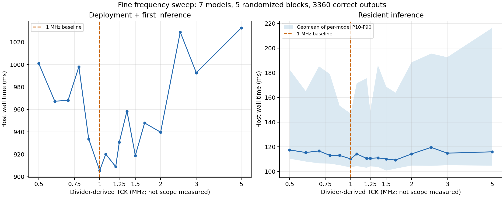

# JTAG 频率扫描：ABI 5 / 50 MHz FPGA

2026-11-11，源码 `aa778875eed49ada6b7b36bf10b1c0cdce2ad3c9`。两轮实验使用相同 EGo1 8×8、trace-off 镜像，系统时钟 50 MHz。
Bitstream SHA-256：`aa082471faef9ca59ef43674d4f7b4e5b222c65fe1c47abd7d3d5bf37866d94d`。

## 结论

建议保持已签核的 **1 MHz TCK**。细扫的 16 档、五轮随机顺序、七模型共 **3360 次推理输出全部正确**。
1 MHz 的加载加首次推理时间最低，为 905.49 ms；驻留推理为 110.20 ms（各模型中位数的等权几何平均）。
名义 1750 kHz（分频 1666.67 kHz）的驻留值 109.28 ms 仅低约 0.84%；按轮配对后相对 1 MHz 的比值为 1.009，
探索性 bootstrap 95% 范围 0.958–1.063，未显示稳定改善。高频测试不是对应频率的物理时序签核。

| 实验 | 测试设置 | 结果与入口 |
|---|---|---|
| 粗扫 | 100/250/500/1000/2000/5000 kHz，三轮交错顺序，756 次推理 | [报告](coarse/report.md)、[CSV](coarse/timing.csv)、[原始证据](coarse/raw_evidence.tar.gz) |
| 细扫 | 500–1500 kHz 每 100 kHz 一档，另加 1750/2000/2500/3000/5000 kHz；五轮随机顺序，3360 次推理 | [报告](fine/report.md)、[CSV](fine/timing.csv)、[原始证据](fine/raw_evidence.tar.gz) |
| 同源实现 | setup WNS +0.458 ns、hold WHS +0.034 ns；TCK 约束为 1 MHz | [实现摘要](implementation/summary.md)、[源码 provenance](implementation/provenance.json)、[CDC 审查](implementation/cdc_review.json) |



## 测量范围

七个模型各使用首个发布 golden 样本；不是完整测试集精度评估。每个频率每轮每模型执行一次加载后推理和五次驻留推理。
时间包括主机 Python、OpenOCD RPC、USB、JTAG、轮询和 ACK，排除编译、文件 I/O、golden 比较及性能计数器读取。
首次时间定义为模型加载调用加首次推理调用，驻留时间只计推理调用。

细扫同时记录名义设置与 FT232H 分频推导值（`30000 / ceil(30000 / request_kHz)` kHz）。
未用示波器测量实际 TCK。仅有五个独立测试轮；配对区间用于探索性描述，没有多重比较校正，不宣称统计上证明最优。
七模型计算周期集合跨频率一致。超过 1 MHz 未重新 STA 或验证电气/长期可靠性，不能因本轮功能通过提升生产默认频率。

结束时均恢复 TCK 1 MHz、协议复位至 idle/error=0，关闭本轮 OpenOCD 并释放 FT232H。物理按键和断电恢复未执行。

## 原始证据与独立复核

为便于 GitHub 浏览，报告、图、CSV、分析 JSON 和扫描记录直接存放；数千个逐次文件保存在两个压缩包中。
压缩包完整包含原始 `build/jtag_clk_*_20261111/`：各轮模型包、输入/预期/实际输出、逐次时序和阶段 CSV、
OpenOCD 日志、下载日志、实验与分析脚本及原始 SHA-256 清单。不包含 bitstream、DCP、工艺 IP 或数据集。
`implementation/` 只保留本次频率实验所依赖的同源实现关键报告；不是整套 FPGA 人工签核归档。

上传前已逐个核验两个原始文件清单，重新读取并比较全部 **4116 次**实际输出，再次从逐次报告重算细扫中位数；
压缩后重新读取压缩包文件并核对原始摘要。[audit.json](audit.json)记录了复核数量及压缩包摘要。

在空目录中解压可以核验每个原始文件（不需要板卡或 Vivado）：

```python
import hashlib, json, tarfile
from pathlib import Path

for kind, name in [('fine', 'jtag_clk_fine_20261111'), ('coarse', 'jtag_clk_sweep_20261111')]:
    with tarfile.open(Path(kind) / 'raw_evidence.tar.gz', 'r:gz') as archive:
        prefix = 'build/' + name + '/'
        manifest = json.load(archive.extractfile(prefix + 'evidence_sha256.json'))
        for path, expected in manifest.items():
            assert hashlib.sha256(archive.extractfile(prefix + path).read()).hexdigest() == expected, path
    print(kind, len(manifest), 'file hashes verified')
```

需要重算图表时，在匹配源码的独立 checkout 根目录解压两个归档到 `build/`，使用安装 Matplotlib 的 Python 运行
`build/jtag_clk_fine_20261111/analyze.py`。脚本基于现有报告计算，不访问硬件。
归档内的 `run_sweep.py` 是当时实际执行脚本，包含本机环境路径；重新实板实验需调整环境、先重新确认镜像身份并使用新输出目录。

目录级 [SHA-256 清单](SHA256SUMS.json)覆盖本次提交的报告、图表、压缩包及实现报告；原始清单的相对路径则对应压缩包内的 build 布局。
