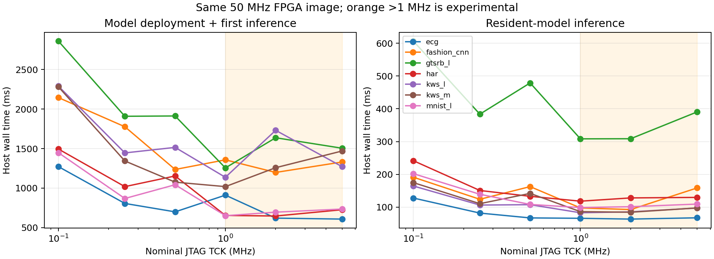

# JTAG TCK 对端到端时间的影响（2026-11-11）

同一 ABI5 / 8×8 / 50 MHz 镜像，SHA-256 `aa082471faef9ca59ef43674d4f7b4e5b222c65fe1c47abd7d3d5bf37866d94d`。本轮重新下载，DONE=1、CRC_ERROR=0。

六个名义 TCK 设置，每档三轮交错顺序；七模型各使用第一个 golden 样本。每轮每模型首次推理一次、驻留推理五次，共 756 次输出校验全部通过。

首次时间 = load_model（含能力检查、上传及提交）+ 第一次 infer（含输入、等待、输出和 ACK）。驻留时间只计 infer。计时包括 Python/RPC/USB/轮询，排除模型编译、文件写入、golden 比较和性能计数器读取。

下表是各模型中位数的等权几何平均；每模型首次样本数 3、驻留样本数 15。不是各任务混合延迟的统计保证。

| TCK MHz | 加载+首次 ms | 驻留推理 ms | 模型加载 ms |
|---:|---:|---:|---:|
| 0.1 | 1895.98 | 214.46 | 1652.36 |
| 0.25 | 1247.16 | 138.30 | 1061.82 |
| 0.5 | 1182.88 | 141.86 | 1036.31 |
| 1 | 962.74 | 107.60 | 822.54 |
| 2 | 1025.63 | 108.06 | 895.60 |
| 5 | 1028.21 | 128.11 | 872.07 |

## 每模型驻留中位数（ms）

| 模型 | 0.1 MHz | 0.25 MHz | 0.5 MHz | 1 MHz | 2 MHz | 5 MHz |
|---|---:|---:|---:|---:|---:|---:|
| ecg | 127.85 | 82.00 | 67.26 | 66.07 | 63.66 | 67.61 |
| fashion_cnn | 191.37 | 124.07 | 162.73 | 97.74 | 92.73 | 158.67 |
| gtsrb_l | 606.54 | 383.67 | 478.93 | 308.43 | 308.77 | 390.51 |
| har | 241.71 | 150.91 | 133.17 | 118.31 | 128.27 | 129.85 |
| kws_l | 164.54 | 106.49 | 107.61 | 82.99 | 85.72 | 97.36 |
| kws_m | 174.85 | 110.68 | 142.04 | 86.37 | 84.60 | 97.70 |
| mnist_l | 202.18 | 139.37 | 108.37 | 98.90 | 101.46 | 109.45 |

完整分阶段结果见各 b*/phases.csv，逐样本时间和实际输出见 report.json 和 actual_*.bin；汇总见 analysis.json、timing.csv。

频率为 OpenOCD adapter speed 设置及查询值，未用示波器测量实际 TCK。现有 routed DCP 按 1 MHz TCK 约束；2/5 MHz 仅为功能与延迟实验，未完成对应频率的重新 STA 或电气裕量验证。不能仅凭这轮通过就提升生产默认频率。

绝对端到端时间受主机调度、OpenOCD RPC 和 USB 影响；外部 TCK 不改变 50 MHz 系统计算时钟。模型驻留后避免重复上传，与提高 JTAG 频率是不同优化。

测试后恢复 TCK 1 MHz 并协议复位，状态见 sweep.json。

## 本轮结论

1 MHz 在本轮几何平均中最低：加载加首次 962.74 ms、驻留 107.60 ms。2 MHz 分别为 1025.63 / 108.06 ms；5 MHz 为 1028.21 / 128.11 ms。相对 1 MHz，5 MHz 驻留时间增加约 19.1%，并未获得收益。建议维持已签核的 1 MHz，后续优先优化 RPC/USB 传输或复用已加载模型。

七模型的硬件计算周期集合在六档频率下完全相同（冷/热缓存个别差一拍）；内部系统时钟保持 50 MHz。较高 TCK 的端到端收益受主机/USB/RPC 开销和抖动限制，当前数据不能单独确定高频变慢的具体原因，也未检验统计显著性。
