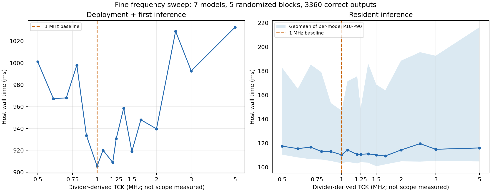
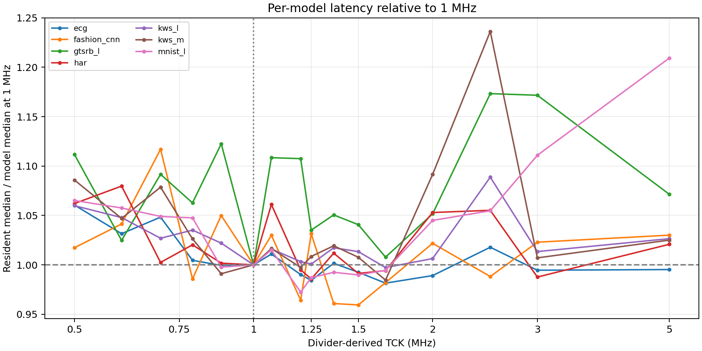

# 细颗粒度 JTAG frequency sweep（2026-11-11）

同一 ABI5 / 8×8 / 50 MHz 镜像，SHA-256 `aa082471faef9ca59ef43674d4f7b4e5b222c65fe1c47abd7d3d5bf37866d94d`。本轮重新下载，DONE=1、CRC_ERROR=0。

16 档、5 轮随机频率顺序；七模型使用各自首个 golden frame。每档每模型首次样本 5 个、驻留样本 25 个。3360 次实际输出全部正确，无失败后重试。

FT232H high-speed MPSSE 使用 60 MHz 基钟，OpenOCD 本地 mpsse.c 按 `N=ceil(30000/request_kHz)`、`TCK=30000/N kHz` 配置。因此名义档位与分频结果不同；没有用示波器测量实际波形。全部 16 个点分频后互不重复。

首次=load_model+第一次 infer；驻留=infer（含输入传输、等待、输出、ACK）。均含主机 RPC/USB/轮询开销，排除编译、文件读写、输出比较和性能计数器读取。协议为当前生产驱动的 burst + batch RPC。

表内时间为各模型样本中位数的等权几何平均。P10/P90 是各模型的驻留分位数再取几何平均，不是把不同任务混在一起的总体分位数。

| 设置 kHz | 分频后 kHz | 加载+首次 ms | 驻留 ms | 驻留 P10–P90 ms | 对 1MHz 配对变化 | 配对 ratio bootstrap 95% |
|---:|---:|---:|---:|---:|---:|---:|
| 500 | 500.00 | 1001.04 | 117.45 | 110.35–182.59 | +8.6% | 1.029–1.142 |
| 600 | 600.00 | 967.35 | 115.38 | 108.07–165.22 | +5.9% | 1.008–1.134 |
| 700 | 697.67 | 968.02 | 116.65 | 106.59–185.29 | +11.9% | 1.041–1.270 |
| 800 | 789.47 | 998.04 | 113.04 | 106.35–179.02 | +6.6% | 1.005–1.159 |
| 900 | 882.35 | 933.70 | 113.01 | 105.12–153.33 | +2.2% | 0.998–1.054 |
| 1000 | 1000.00 | 905.49 | 110.20 | 103.25–147.02 | +0.0% | 1.000–1.000 |
| 1100 | 1071.43 | 920.15 | 114.21 | 104.40–171.46 | +6.1% | 1.020–1.110 |
| 1200 | 1200.00 | 908.92 | 110.57 | 103.00–175.61 | +5.0% | 0.976–1.116 |
| 1300 | 1250.00 | 930.68 | 110.70 | 104.16–148.85 | +1.0% | 0.983–1.043 |
| 1400 | 1363.64 | 958.62 | 111.01 | 103.69–186.26 | +8.7% | 0.990–1.236 |
| 1500 | 1500.00 | 918.89 | 110.09 | 100.74–168.70 | +3.7% | 0.960–1.132 |
| 1750 | 1666.67 | 947.94 | 109.28 | 102.31–163.92 | +0.9% | 0.958–1.063 |
| 2000 | 2000.00 | 939.69 | 114.22 | 104.80–188.54 | +8.1% | 1.009–1.161 |
| 2500 | 2500.00 | 1028.98 | 119.55 | 104.62–195.64 | +16.3% | 1.067–1.247 |
| 3000 | 3000.00 | 992.68 | 114.84 | 105.04–192.67 | +10.2% | 0.975–1.282 |
| 5000 | 5000.00 | 1032.64 | 115.94 | 104.72–216.39 | +13.4% | 1.030–1.322 |

配对指标：每轮先按七模型驻留中位数求几何平均，再除以同轮 1 MHz 值，最后跨五轮求几何平均。置信区间按整轮配对比值重采样 10000 次；只有五个独立测试轮，且测试很多频率、未做多重比较校正，因此区间仅作探索性波动描述，不能把最低样本值宣称为已证明最优。

计算周期集合跨频率保持一致：True。系统计算时钟保持 50 MHz；端到端波动不能直接归因于核心计算。

原实现只按 TCK 1 MHz 做时序签核。超过 1 MHz 的点是功能/延迟实验；未重新 STA、电气测量或做长期可靠性保证。

完整每模型数据见 timing.csv；分阶段时间和实际输出在各 b*/report.json、phases.csv 与 actual_*.bin。最终状态及 TCK 恢复记录见 sweep.json。

## 本轮结论

建议保持默认 1 MHz。本轮 1 MHz 加载加首次推理的几何平均为 905.49 ms，为各档最低；驻留推理为 110.20 ms。名义 1750 kHz（分频 1666.67 kHz）的驻留中位数几何平均最低，为 109.28 ms，只比 1 MHz 低约 0.84%；但五轮配对比值为 1.009（探索性 bootstrap 95% 范围 0.958–1.063），未显示稳定改善。不能把这一小幅最低值认定为最优频率。

名义 1300 kHz（分频1250 kHz）配对比值约 1.010（0.983–1.043）；5 MHz 则约 1.134（1.030–1.322），本轮反而较慢。高频下仍有较大的主机/RPC/USB 延迟波动，不能只按 TCK 倍数推断端到端收益。

已恢复 TCK 1 MHz、协议复位至 idle/error=0，并关闭本轮 OpenOCD、释放 FT232H。所有测试使用同一镜像，没有修改生产 RTL。
